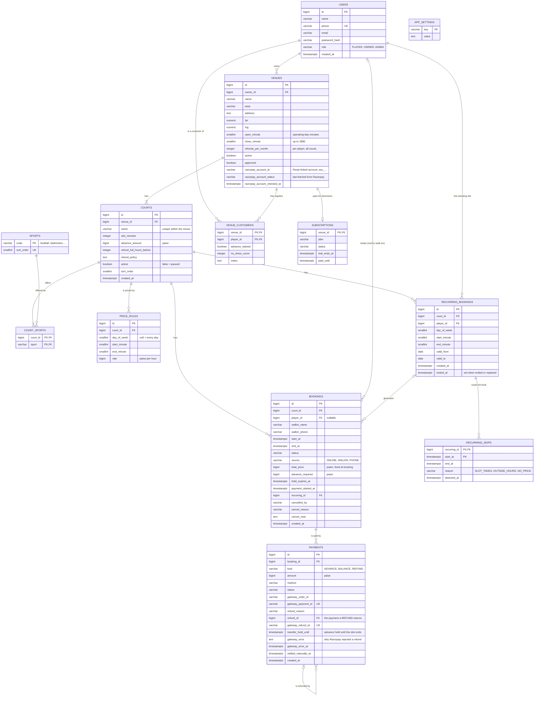

# TurfUp: DBMS notes

Notes for the viva. The schema lives only in Flyway migrations: `backend/src/main/resources/db/migration`
(V1 is the base schema; V2-V8 add the trigger, approval, refunds, cancellation reasons, the hold expiry
procedure, recurring-booking generation and the completion delay; V9-V11 add Razorpay linked accounts,
refunds and held transfers; V12-V13 turn turfs into multi-sport venues with courts). PostgreSQL 16.

1. [ER diagram](#er-diagram)
2. [Normalization](#normalization)
3. [Integrity constraints](#integrity-constraints)
4. [The exclusion constraint and the booking deadlock](#concurrent-bookings-the-exclusion-constraint-deadlock)
5. [Transactions and isolation](#transactions-and-isolation)
6. [Trigger: counting no-shows](#trigger-counting-no-shows)
7. [Stored procedure: releasing expired holds](#stored-procedure-releasing-expired-holds)
8. [Migrating turfs to venues and courts](#migrating-turfs-to-venues-and-courts)

## ER diagram

A **venue** is the place (owner, address, opening hours, Razorpay account, approval). It has **courts**, the
things that are booked: a football turf, badminton court 2, a pitch shared by football and cricket. Bookings,
price rules and standing slots belong to a court; regulars, waivers and the monthly refund allowance belong
to the venue.



How to read it: `||--o{` is one-to-many; `||--|{` means at least one (a venue has one or more courts, a court
offers one or more sports); `|o--o{` means the "one" side is optional (a walk-in booking has no player; a
one-off booking has no recurring booking). `COURT_SPORTS` is the associative entity of the many-to-many
relationship between courts and sports, and `VENUE_CUSTOMERS` that of venues and players, carrying attributes
of the pair (the waiver and no-show count belong to "this player at this venue", not to either alone).

"At least one court per venue" and "at least one sport per court" cannot be a plain constraint (they span two
tables); the setup service enforces them, and the migration creates every venue with a court.

**Conventions** used everywhere: money is integer paise (`bigint`, never floating point); instants are
`timestamptz`, shown in IST at the edges; times of day are minutes from the start of the venue's *operating
day* (0-2880, so a venue open 6 AM-2 AM is `360..1560`); enumerations are `varchar` + `CHECK`, so adding a
value is a one-line migration. Sports are the exception: they are rows of `sports`, because players browse by
them and the list is referenced by a foreign key.

## Normalization

Each table is checked against the normal forms using its functional dependencies (FDs).

### 1NF: atomic values, no repeating groups

Every column holds one value; there are no repeating column groups such as `rule1_rate, rule2_rate`. Price
rules, payments, bookings and courts are separate rows in their own tables rather than lists inside a venue.

The sports a court offers are rows of `court_sports (court_id, sport)`. Before V12 they were an array,
`turfs.sports text[]`, a documented exception to 1NF that was acceptable while the list was only ever shown
whole. Browsing "venues with a badminton court" needs to filter and index by one sport, so V12 moved them to
the associative table, with an index on `sport` and a foreign key to `sports`.

### 2NF: no partial dependency on part of a composite key

`venue_customers` has a composite key, `(venue_id, player_id)`:

- `(venue_id, player_id) → advance_waived, no_show_count, notes`

Each non-key attribute needs *both* parts: a waiver is granted by one venue to one player; the same player can
be waived at venue A and not at venue B. Nothing depends on `player_id` alone (the player's name and phone stay
in `users`), so the table is in 2NF.

`court_sports (court_id, sport)` is all key: it has no non-key attributes, so it is trivially in 2NF. The
sport's display order lives in `sports`, because it depends on the sport alone; copying it here would be a
partial dependency.

`recurring_skips` has the key `(recurring_id, start_at)`: one row per occurrence that could not be booked.
`end_at`, `reason` and `detected_at` describe that occurrence, so they need both parts; nothing about the
standing slot itself (player, court, day, time) is repeated here, since that depends on `recurring_id` alone
and lives in `recurring_bookings`. Every other table has a single-column key, so 2NF holds automatically.

### 3NF: no transitive dependency (non-key → non-key)

| Table | Key | Key dependencies | Transitive dependencies avoided |
|---|---|---|---|
| `users` | `id` (also `phone`) | `id → name, phone, email, password_hash, role, created_at` | — |
| `venues` | `id` | `id → owner_id, name, area, address, hours, refunds_per_month, flags, Razorpay account` | the owner's name/phone are not copied here; they come through `owner_id → users` |
| `courts` | `id` (also `(venue_id, name)`) | `id → venue_id, name, slot_minutes, advance_amount, refund rules, active, sort_order` | the venue's hours and account are not copied; they come through `venue_id → venues` |
| `price_rules` | `id` | `id → court_id, day_of_week, start_minute, end_minute, rate` | — |
| `bookings` | `id` | `id → court_id, player_id, times, status, source, money, hold/payment times, cancellation` | no `venue_id`: it would depend on `court_id` (`court_id → venue_id`), not on the booking; queries per venue join `courts` |
| `payments` | `id` (also `gateway_payment_id`) | `id → booking_id, kind, amount, method, status, gateway ids, refund details` | no copy of the court, venue or player: reached through `booking_id` |
| `venue_customers` | `(venue_id, player_id)` | see 2NF | — |
| `recurring_bookings` | `id` | `id → court_id, player_id, day_of_week, start/end minute, validity, created_at, ended_at` | — |
| `recurring_skips` | `(recurring_id, start_at)` | `(recurring_id, start_at) → end_at, reason, detected_at` | the player's name is not copied; it comes through `recurring_id → player_id → users` |
| `sports` | `code` | `code → sort_order` | — |
| `app_settings` | `key` | `key → value` | — |

**Not storing `bookings.venue_id` is the textbook case.** It would make the owner's "all bookings at my venue"
query one join shorter, but `booking → court → venue` is exactly the transitive dependency 3NF removes: a court
moved to another venue (or a typo fixed by hand) would leave bookings pointing at two different venues. With
only `court_id`, the venue of a booking has one source of truth.

**Snapshot columns are not transitive dependencies.** `bookings.total_price` is calculated from the court's
`price_rules` and `bookings.advance_required` from `courts.advance_amount` (or 0 for a waived regular). It can
look like `court_id, start_at, end_at → total_price`, which would be transitive. It is not, because the
rules change over time and the booking must keep the price agreed when it was made ("never recompute old
bookings"). The stored value is a fact about the booking, determined by the booking. The same applies to
`hold_expires_at` (hold length at that moment) and `walkin_name` (only used when there is no `player_id`;
for registered players the name is read from `users`, never copied).

**Deliberate derived value: `venue_customers.no_show_count`.** It equals the number of this player's NO_SHOW
bookings on this venue's courts, so it could be computed with `count(*)`. It is stored because the owner sees it
on every regulars list and decides waivers by it, and it is kept correct by a database trigger (section 6)
rather than by application code, so it cannot drift.

### BCNF: every determinant is a candidate key

Every non-trivial FD above has a key (or another candidate key) on its left side:

- `users`: `id` and `phone` are both candidate keys (`phone` is `UNIQUE NOT NULL`), so `phone → …` is fine.
- `courts`: `id` and `(venue_id, name)` are both candidate keys (`courts_venue_name_key`), so a court is also
  identified by "Badminton 2 at venue 7".
- `payments`: `gateway_payment_id` is unique when present, a candidate key for gateway payments.
- No table has a non-key attribute that determines another attribute. For example, `area` does not
  determine anything about a venue (two venues in Cidco have different everything else), and `role` does not
  determine any other user column.

So the schema is in BCNF, apart from the documented stored no-show count.

## Integrity constraints

The database enforces the rules itself, so no code path (or manual `psql` session) can break them:

| Rule | Constraint |
|---|---|
| No double booking on a court | `bookings_no_overlap` exclusion constraint on `(court_id, tstzrange(start_at, end_at))` (next section) |
| One active hold per player | partial unique index `ON bookings (player_id) WHERE status = 'HELD'` |
| Webhook idempotency | `UNIQUE (gateway_payment_id)` |
| Balance received once | partial unique index `ON payments (booking_id) WHERE kind = 'BALANCE' AND status = 'SUCCEEDED'` |
| A court's price rules don't overlap | exclusion on `(court_id, COALESCE(day_of_week, 0), int4range(start_minute, end_minute))` |
| Court names are unique within a venue | `courts_venue_name_key UNIQUE (venue_id, name)` |
| A court offers only known sports | `court_sports.sport REFERENCES sports (code)` |
| Valid opening hours | `CHECK (close_minute > open_minute AND close_minute - open_minute <= 1440)` and ranges |
| Online bookings have a player; owner entries have a player or a name | `bookings_customer_check` |
| A HELD row has an expiry | `CHECK (status <> 'HELD' OR hold_expires_at IS NOT NULL)` |
| Owner cancellations give a reason; OTHER needs a note | `bookings_cancellation_check` (`CASE` on status and `cancelled_by`) |
| Refund rows say why | `CHECK ((kind = 'REFUND') = (refund_reason IS NOT NULL))` |
| A Razorpay refund names the payment it returns; each Razorpay refund is recorded once | `payments_gateway_refund_source_check`, `UNIQUE (gateway_refund_id)` |
| A linked account id is well formed | `CHECK (razorpay_account_id ~ '^acc_[A-Za-z0-9]{8,24}$')` |
| Only advances are held; only refunds carry a gateway error; only a SUCCEEDED Razorpay refund is settled manually | `payments_transfer_hold_check`, `payments_gateway_error_check`, `payments_settled_manually_check` |
| Money is never negative | `CHECK (amount > 0)`, `CHECK (rate >= 0)`, `CHECK (advance_amount >= 0)`, … |
| A standing slot's occurrence is generated once | unique index `ON bookings (recurring_id, start_at) WHERE recurring_id IS NOT NULL` |
| Every reference points at a real row | foreign keys on every `*_id` column |

## Concurrent bookings: the exclusion-constraint deadlock

### The guarantee

`bookings` has an exclusion constraint:

```sql
CONSTRAINT bookings_no_overlap EXCLUDE USING gist (
    court_id WITH =,
    tstzrange(start_at, end_at) WITH &&
) WHERE (status IN ('HELD', 'CONFIRMED'))
```

No two active bookings on the same court can have overlapping time ranges. `tstzrange` is half-open
(`[start, end)`), so a 7-8 PM booking and an 8-9 PM booking do not overlap. Two courts of one venue are booked
independently: badminton courts 1 and 2 can both be taken at 8 PM.

### What went wrong

The required test fires 50 concurrent `hold()` calls for the same slot and expects exactly one success
and 49 clean "slot unavailable" errors. Its first run failed: several requests got
`ERROR: deadlock detected` (SQLSTATE `40P01`) instead.

**Cause.** An exclusion constraint is checked *after* the new row's index entry is written:

1. Transaction A inserts its row and GiST index entry, then scans the index for conflicting entries.
2. Transaction B does the same at the same moment.
3. A finds B's entry. B has not committed yet, so A cannot know whether B's row will exist. A waits
   for B to finish.
4. B finds A's entry and waits for A.

A waits for B and B waits for A. PostgreSQL's deadlock detector notices the cycle (after
`deadlock_timeout`, 1 s by default) and aborts one of them with `40P01`. With 50 transactions inserting
at once, cycles like this are almost certain.

Unique B-tree indexes avoid this because their uniqueness check and insert happen together under a
lock on the index page, so the second inserter simply waits for the first. Exclusion constraints have
no such step. The PostgreSQL source (`execIndexing.c`) calls these "unprincipled deadlocks".

Double booking never happened: the aborted transaction rolled back. The problem was that a losing
player got a confusing server error instead of "please pick another time".

### The fix: lock the court row first

`BookingService.hold()` begins by locking the court, reading its venue's hours in the same statement:

```sql
SELECT c.venue_id, v.open_minute, v.close_minute, c.slot_minutes, c.advance_amount, now() AS db_now
FROM courts c JOIN venues v ON v.id = c.venue_id
WHERE c.id = :courtId AND c.active AND v.active AND v.approved
FOR NO KEY UPDATE OF c;
```

All booking transactions for one court now queue on this row lock. Each one runs the expiry update and
the insert alone, then commits, and only then does the next one start. The next one finds a
*committed* conflicting row, so the exclusion constraint fails immediately with a clean violation
(`23P01`), which the service turns into `SlotUnavailableException`. Holds on different courts, even of the
same venue, lock different rows and still run in parallel. `OF c` locks only the court row: the venue row is
read, not locked, so bookings on a venue's several courts never queue behind each other.

Why `FOR NO KEY UPDATE` and not `FOR UPDATE`: inserting any row that references `courts` (a booking, a
price rule, a court sport) takes a `FOR KEY SHARE` lock on the court row for the foreign-key check.
`FOR UPDATE` conflicts with `FOR KEY SHARE` and would block those unrelated inserts. `FOR NO KEY UPDATE`
does not, because we never change the court's key.

### "Any free court"

A player can ask for "any free badminton court". `BookingService.holdAnyCourt` ranks the venue's courts for
that sport (cheapest for the slot first, then display order) and tries them one by one, **each attempt in its
own transaction holding one court lock**. A court taken in the meantime fails cleanly (`23P01`) and the next is
tried. Because no transaction ever holds two court locks, two players racing for "any court" cannot deadlock
each other; `MultiCourtTest` fires 50 concurrent any-court holds at three courts and asserts exactly three
succeed, one per court.

### Lock order

Every path takes locks in the same order: **venue, then court(s) in id order, then booking and payment rows**.

| Path | Locks |
|---|---|
| Hold, owner walk-in/phone entry, standing-slot generation | the court |
| Moving a standing slot to another court | both courts, lower id first |
| Cancellation (player or owner) | the venue (the monthly refund allowance is per venue), then the booking |
| Changing a court's slot length or prices | the venue, then that court |
| Changing the venue's opening hours | the venue, then all its courts in id order |
| Hold expiry procedure | one court at a time, in id order, committing after each |

No path locks a court and then its venue, so lock waits cannot form a cycle. Setup changes take the court locks
so that a booking is never checked against hours or prices that are changing under it.

### Why the constraint is still the real guarantee

The row lock is only a convention that well-behaved code follows, and it never checks anything itself.
The exclusion constraint is enforced by the database on every insert and update, whatever path the row
comes from:

- a code path that forgets the lock;
- a manual `INSERT` in `psql`;
- a status change, such as an admin manually reviving an EXPIRED hold (the app itself refunds late payments instead).

Without the lock, those paths may deadlock or throw an ugly error, but they still cannot create a double
booking. The lock exists to make concurrent conflicts fail *cleanly*. The constraint is what makes them
fail at all.

Rule in `CLAUDE.md`: every booking insert path locks the court row first.

## Transactions and isolation

### One transaction per business action

Every state change of a booking or payment happens inside one database transaction: each public method of
`BookingService`, `PaymentService`, `CancellationService` and `VenueSetupService` is `@Transactional` (or runs
in an explicit `TransactionTemplate`). Holding a slot, for example, is all-or-nothing:

```
BEGIN                                                          -- READ COMMITTED
  SELECT ... FROM courts ... WHERE c.id = 1003 FOR NO KEY UPDATE OF c   -- 1. queue behind other bookings on court 1003
  (validate the slot against now(), the venue's hours, the court's slot length)
  (price it from the court's price_rules)
  UPDATE bookings SET status = 'EXPIRED' WHERE ... hold_expired(...)   -- 2. clear stale holds in the way
  INSERT INTO bookings (court_id, ... 'HELD' ...)                       -- 3. constraint decides
COMMIT
```

If step 3 violates the exclusion constraint, the whole transaction rolls back, including step 2, and the
player gets "slot unavailable". Atomicity means there is never a half-done booking; durability means a
confirmed booking survives a crash once `COMMIT` returns.

### Isolation level: READ COMMITTED (PostgreSQL's default), plus explicit locks

TurfUp uses READ COMMITTED: each *statement* sees all data committed before that statement started. It does
not rely on the isolation level to prevent races. It relies on three things that work at any level:

1. **Constraints for invariants.** The exclusion constraint, unique indexes and checks are enforced by the
   database regardless of isolation. Two transactions can never both commit overlapping bookings.
2. **Row locks for "check, then act" sequences.** Wherever the code reads something and then decides based
   on it, it first locks the row that serializes the decision (see the lock order table above):
   - booking paths lock the **court** row (`FOR NO KEY UPDATE`);
   - cancellations lock the **venue** row, because the refund allowance is counted per venue;
   - paying, confirming and no-show lock the **booking** row (`FOR UPDATE`);
   - a payment webhook locks the **payment order** row, so duplicate deliveries run one after the other.
3. **Fresh reads after waiting.** Under READ COMMITTED, the statement *after* a lock wait sees what the
   transaction it waited for committed.

Point 3 is what makes the monthly refund rule correct. A player cancels two bookings at once, on two
different courts of venue 7:

```
T1: lock venue 7 ──────────────── count refunds this month at venue 7 = 0 → refund, COMMIT
T2: lock venue 7 (waits for T1) ──────────────────────────────────────── count = 1 → no refund
```

T2's count runs after T1 committed, so it sees T1's refund. Locking the *court* would not be enough here:
the two bookings are on different courts, so the two cancellations would not wait for each other.
`CancellationTest.twoConcurrentCancellationsGetAtMostOneRefund` fires 8 cancellations at once and asserts
exactly one refund; `MultiCourtTest.theMonthlyRefundAllowanceIsSharedByAllCourtsOfTheVenue` checks the
allowance across courts.

### Why not REPEATABLE READ or SERIALIZABLE?

- **REPEATABLE READ** would make the code above *wrong*. The whole transaction reads from one snapshot taken
  at its first statement, the venue lock, which starts *before* the wait. After waiting, T2's count would
  still read the old snapshot, see 0 refunds, and refund a second time. (Updates to the same row would fail
  with a serialization error, but this check is a count of *other* rows.)
- **SERIALIZABLE** would be correct, but it turns contention into errors: when 50 players race for one slot,
  many transactions would abort with `40001 could not serialize access` and every service would need a
  retry loop. The constraint-plus-lock design gets the same correctness with a clean "slot unavailable" for
  the losers and no retries.
- READ COMMITTED with the locks above is also the cheapest: transactions on different courts never wait for
  each other.

### Where transactions are deliberately split

- **Simulated checkout** (`CheckoutService`) runs "start payment" and "payment captured" as two separate
  transactions, exactly like a real gateway, where the webhook arrives later on another connection.
- **"Any free court"** tries each court in its own transaction, so it never holds two court locks.
- **The hold expiry procedure** commits once per court (`COMMIT` inside the procedure), so it holds at most one
  court lock at a time. It is therefore called outside any transaction.
- **Razorpay checkout** (`PaymentService.startAdvancePayment`) stamps `payment_started_at` in one short
  transaction, calls Razorpay to create the order with no transaction open, then records the PENDING payment
  in a second one. No court, venue or booking lock is ever held while waiting on the network.
- **Razorpay refunds** are recorded PENDING inside the booking transaction and sent to Razorpay only after it
  commits (`@TransactionalEventListener(AFTER_COMMIT)`), so a rolled-back cancellation never moves money. If the
  send fails, the reconciliation job retries it; each refund carries its own id in Razorpay's notes, so a retry
  finds a refund that already went through instead of refunding twice.

## Trigger: counting no-shows

When an owner marks a booking NO_SHOW, the player's `no_show_count` at that venue goes up, whichever court the
booking was on. The database does this, not the Java code (created in V2, rewritten for courts in V12):

```sql
CREATE OR REPLACE FUNCTION count_no_show() RETURNS trigger LANGUAGE plpgsql AS $$
BEGIN
    INSERT INTO venue_customers (venue_id, player_id, no_show_count)
    SELECT c.venue_id, NEW.player_id, 1 FROM courts c WHERE c.id = NEW.court_id
    ON CONFLICT (venue_id, player_id)
        DO UPDATE SET no_show_count = venue_customers.no_show_count + 1;
    RETURN NULL;
END;
$$;

CREATE TRIGGER bookings_count_no_show
    AFTER UPDATE OF status ON bookings
    FOR EACH ROW
    WHEN (NEW.status = 'NO_SHOW' AND OLD.status <> 'NO_SHOW' AND NEW.player_id IS NOT NULL)
EXECUTE FUNCTION count_no_show();
```

- **Why a trigger.** The count stays correct however the status changes: the owner's API call, an
  admin fixing data in `psql`, or a future batch job. No code path can forget to increment it.
- **`WHEN` clause.** The trigger fires only on the change *into* NO_SHOW, so setting NO_SHOW twice counts
  once, and walk-ins with no registered player (`player_id IS NULL`) are skipped.
- **Court to venue.** The booking only knows its court (3NF), so the function looks up the venue with
  `INSERT ... SELECT ... FROM courts`.
- **Upsert.** A player may have no `venue_customers` row yet (rows are created on first waiver or
  no-show). `INSERT ... ON CONFLICT DO UPDATE` creates or increments it in one statement, with no race
  between "check if it exists" and "insert".
- **`AFTER ... RETURN NULL`.** An AFTER trigger cannot change the booking row, so the return value is
  ignored. It runs inside the same transaction as the status update: if anything fails, both roll back.

The owner sees the count when deciding whether to revoke a regular's advance waiver.

## Stored procedure: releasing expired holds

When a player starts booking, the slot is HELD for a few minutes. Holds that run out must be released so the
slot shows as free again. The database does this (`V6__release_expired_holds.sql`, per court since V12):

```sql
CREATE FUNCTION hold_expired(hold_expires_at timestamptz, payment_started_at timestamptz, grace_minutes integer)
    RETURNS boolean LANGUAGE sql STABLE AS
$$
SELECT now() > hold_expires_at
       AND (payment_started_at IS NULL OR now() > hold_expires_at + make_interval(mins => grace_minutes))
$$;

CREATE OR REPLACE PROCEDURE release_expired_holds(INOUT released integer DEFAULT 0) LANGUAGE plpgsql AS
$$
DECLARE
    grace   integer := (SELECT value::integer FROM app_settings WHERE key = 'grace_minutes');
    court   bigint;
    expired integer;
BEGIN
    released := 0;
    FOR court IN SELECT DISTINCT court_id FROM bookings
                 WHERE status = 'HELD' AND hold_expires_at < now()
                 ORDER BY court_id
    LOOP
        PERFORM 1 FROM courts WHERE id = court FOR NO KEY UPDATE;  -- same lock as every booking path
        UPDATE bookings SET status = 'EXPIRED'
        WHERE court_id = court AND status = 'HELD'
          AND hold_expired(hold_expires_at, payment_started_at, grace);
        GET DIAGNOSTICS expired = ROW_COUNT;
        released := released + expired;
        COMMIT;                                                    -- release this court's lock now
    END LOOP;
END;
$$;
```

A Spring `@Scheduled` job (`HoldExpiryJob`) runs `CALL release_expired_holds()` every minute.

**One rule, one place.** "Has this hold expired?" is the function `hold_expired()`. The Java queries (booking,
availability, owner schedule) call the same function through `HoldExpirySql`, so the job and the app can
never disagree. A hold whose payment started in time stays valid through the 2-minute grace window. The grace
length comes from `app_settings`, and the clock is the database's `now()`, never the app server's.

**Why a function and a procedure.** A *function* returns a value and can be used inside a query (`WHERE
hold_expired(...)`); it is `STABLE` because it reads `now()` but changes nothing. A *procedure* is called
with `CALL`, may change data, and (unlike a function) may `COMMIT` part-way through. That is what lets it
release one court at a time.

**Locking order.** Every booking path locks the court row first and the booking rows second. The procedure
does the same, court by court in id order, and commits after each court:

- it never holds more than one court lock, so it cannot form a lock cycle with a booking that holds another
  court's lock;
- a player booking court 1003 waits at most for the few milliseconds it takes to expire that court's holds,
  not for the whole run;
- the test `HoldExpiryJobTest.waitsForTheCourtLockLikeEveryBookingPath` holds a court lock in one transaction
  and checks the procedure queues behind it; `runsAlongsideConcurrentHoldsWithoutDeadlocksOrDoubleBooking`
  runs it during 24 concurrent hold attempts across 6 courts.

**Not the only safety net.** The booking transaction also expires the stale holds it collides with before it
inserts, so a slot is never blocked by an expired hold even if the job has not run yet. The job keeps
availability accurate for slots nobody is currently trying to book.

Because of the `COMMIT`s, the procedure must be called on its own (autocommit), not inside `BEGIN ... END`.

## Migrating turfs to venues and courts

V12 changed the shape of a live schema: every turf became a venue with one court, and bookings, price rules
and standing slots moved from the turf to the court. Three DBMS ideas made it safe.

**1. Transactional DDL: all or nothing.** In PostgreSQL, `ALTER TABLE`, `CREATE TABLE` and `CREATE FUNCTION`
run inside the migration's transaction, so V12 either applies completely or not at all. This matters because
**PL/pgSQL is late-bound**: a function body is parsed and its table and column names resolved only when it runs.
The moment `turfs` is renamed or `bookings.turf_id` dropped, `release_expired_holds()` and `count_no_show()`
would fail at their next call, until they are replaced. Doing the rename, the column moves and the
`CREATE OR REPLACE` of both in one migration means there is never a committed state with broken database logic.
`VenueMigrationTest.anUnknownSportStopsTheMigrationAndChangesNothing` checks that a failing V12 leaves the V11
schema and data untouched.

**2. Keeping ids, so nothing changes meaning.**

```sql
ALTER TABLE turfs RENAME TO venues;                 -- same rows, same ids, foreign keys follow the table
INSERT INTO courts (id, venue_id, name, slot_minutes, advance_amount, refund_full_hours_before, refund_policy)
SELECT id, id, 'Main', slot_minutes, advance_amount, refund_full_hours_before, refund_policy FROM venues;
SELECT setval('courts_id_seq', (SELECT max(id) FROM courts) + 1, false);
```

Turf 7 is venue 7, and its court is court 7, so old links (`/turfs/7`) still find the right place. The backfill
of `court_id` does not rely on the equal ids, though: it joins on the relationship, which is correct even
after more courts exist.

```sql
ALTER TABLE bookings ADD COLUMN court_id bigint REFERENCES courts (id);
UPDATE bookings b SET court_id = c.id FROM courts c WHERE c.venue_id = b.turf_id;  -- exactly one court per venue here
ALTER TABLE bookings ALTER COLUMN court_id SET NOT NULL;
ALTER TABLE bookings DROP CONSTRAINT bookings_no_overlap;
ALTER TABLE bookings ADD CONSTRAINT bookings_no_overlap EXCLUDE USING gist (court_id WITH =, tstzrange(start_at, end_at) WITH &&)
    WHERE (status IN ('HELD', 'CONFIRMED'));
ALTER TABLE bookings DROP COLUMN turf_id;
```

Re-adding the exclusion constraint validates every existing row; it cannot fail, because the mapping is
one-to-one and the old constraint already held per turf.

**3. Expand, then contract.** V12 only adds and moves; the old copies of the moved columns (`slot_minutes`,
`advance_amount`, the refund settings, the `sports` array) stay on `venues` until V13 drops them. Each step is
small enough to review on its own, and the free-text sports are checked on the way: a value that is not one of
the known codes stops the migration with a message instead of being guessed.

Committed migrations are never edited (they may already have run somewhere); every change is a new migration.
`VenueMigrationTest` migrates a fresh database to V11, seeds it the way the app wrote data (a booking across
midnight, a live hold, standing slots, payments, regulars), runs V12-V13 and checks the ids, the exclusion
constraint per court, the trigger and the procedure.
